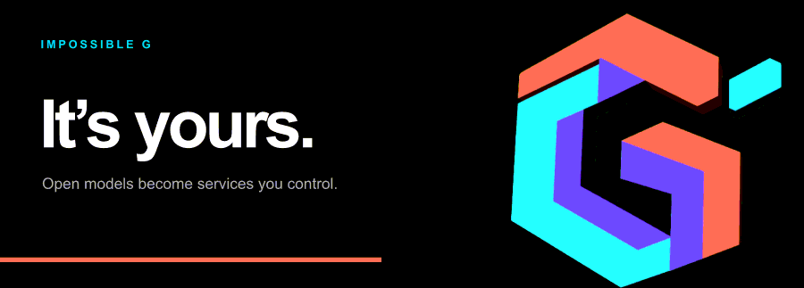
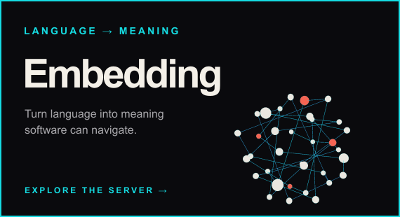
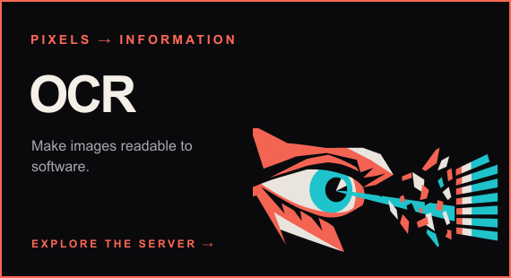
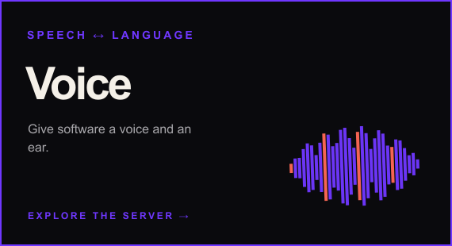
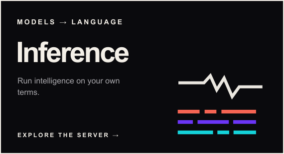

  

  <a href="https://impossibleg.org">Website</a>&nbsp;&nbsp;·&nbsp;&nbsp;
  <a href="https://impossibleg.org/mission">Mission</a>&nbsp;&nbsp;·&nbsp;&nbsp;
  <a href="#the-servers">Servers</a>

## Infrastructure you can run and own

Impossible G turns open models into complete local services. Each repository includes the server, protocols, model setup, health checks, observability, documentation, and release machinery needed to put one capability to work.

Applications connect through familiar APIs while the models and runtime remain under your control.

<h2 id="the-servers">The servers</h2>

<table>
  <tr>
    <td width="50%"></td>
    <td width="50%"></td>
  </tr>
  <tr>
    <td width="50%"></td>
    <td width="50%"></td>
  </tr>
</table>

| Service | What it brings into your infrastructure |
| --- | --- |
| [Embedding](https://github.com/impossibleG/impossible-embeddings) | Search, retrieval, recommendations, and memory built from local text representations. |
| [OCR](https://github.com/impossibleG/impossible-ocr) | Document reading and structured text extraction from local images. |
| [Voice](https://github.com/impossibleG/impossible-voice) | Streaming transcription and speech synthesis for products and private workflows. |
| [Inference](https://github.com/impossibleG/impossible-inference) | Streaming completion and conversation with open language models. |

## One operating idea

The model, its runtime, and the service around it belong together. Impossible G packages those pieces as infrastructure with clear contracts and conservative defaults. The servers operate locally after setup and expose familiar interfaces to the applications that use them.

<strong>It’s yours.</strong>

<a href="https://impossibleg.org">impossibleg.org</a>

